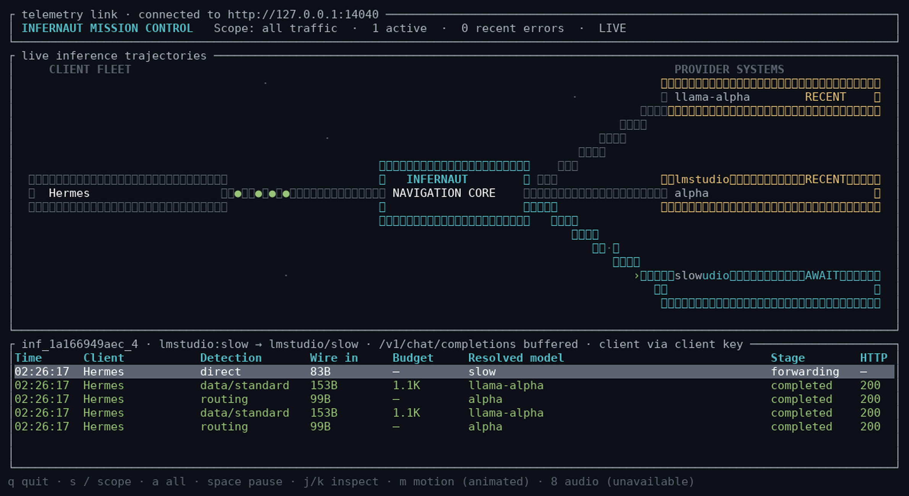
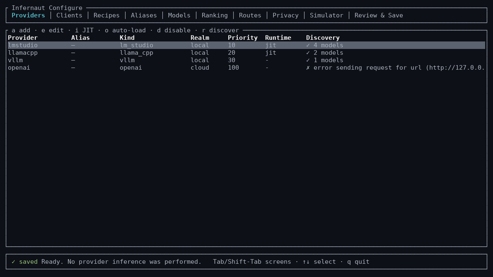
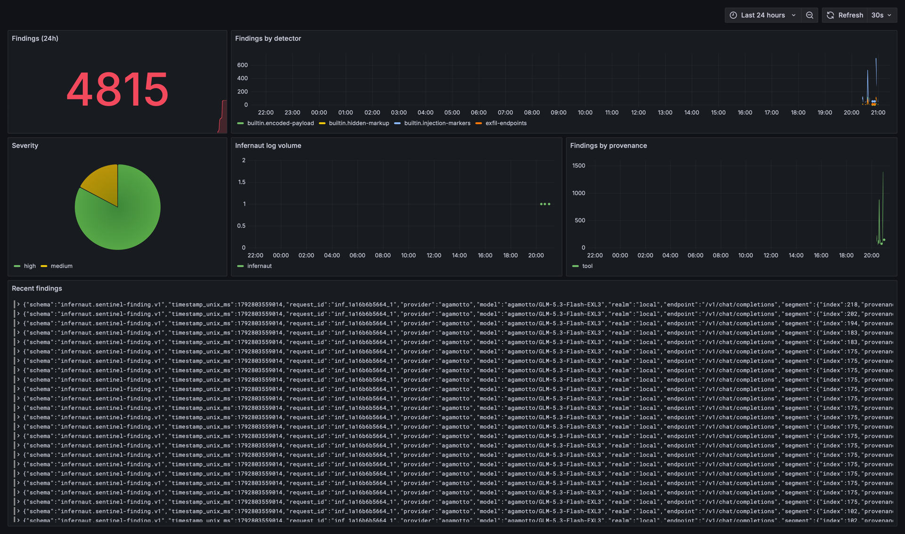

# Infernaut

[](https://github.com/SyntaxGeek/infernaut/actions/workflows/ci.yml)
[](LICENSE)
[](https://www.rust-lang.org)

Infernaut is a privacy-aware inference gateway for homelabs and self-hosted
setups. It combines models from local runtimes — LM Studio, llama.cpp, vLLM —
and cloud providers — OpenAI, Ollama Cloud, subscription endpoints — into
one OpenAI- and Anthropic-compatible catalog, without hiding which provider
serves a request or where its data is allowed to go.

Point any OpenAI- or Anthropic-compatible harness at a single base URL, pick
models from one `/v1/models` list, and let fail-closed realm routing enforce
the privacy boundary. Infernaut does not run an agent loop, execute tools,
maintain conversations, or rewrite prompts.

> [!NOTE]
> Infernaut is an early, operator-focused project. Its configuration format
> and provider adapters may change before 1.0. Test upgrades against a backup
> and avoid exposing the listener directly to an untrusted network.



*Infernaut Mission Control — the read-only live route observer.*

## Why Infernaut

- **One catalog, visible boundaries.** A unified `GET /v1/models` with stable
  `provider/model` IDs and `x-infernaut` metadata: context length, load state,
  quantization, and capabilities, per provider. Nothing is anonymized away.
- **Hard privacy enforcement.** Realm-constrained routing with no implicit
  retries or fallback, a global `local_only` lock, and a per-request
  `x-infernaut-privacy: local_only` control that fails closed *before* model
  activation or upstream traffic.
- **Harness-aware dispatch.** Route recipes give Claude Code and Hermes
  separate primary, background, subagent, classifier, vision, and compression
  targets under one endpoint; exact aliases give cron jobs a stable model name.
- **Optional adaptive routing.** Deterministic task/operation/effort
  classification with a shadow mode for reviewing decisions before activation,
  manual strength overlays, and tool-loop model pinning without retaining
  conversation content.
- **Operator tooling.** A guided terminal configurator with simulation, diff
  review, and atomic saves; the Mission Control observer; explicit capability
  probes with dry-run planning; in-memory content-free metrics; and
  provider-error diagnostics that preserve upstream messages.

## Quick start

Rust 1.89 or newer is required.

```bash
cp infernaut.example.toml infernaut.toml
cp .env.example .env
# Edit .env with the server, client, and provider credentials you use.
cargo run --release -- infernaut.toml
```

For repeated use, build the binaries once and run the release executable
directly:

```bash
cargo build --release --bins
./target/release/infernaut infernaut.toml
```

The binary automatically loads `.env` from the directory containing the
selected TOML configuration before starting any command. Existing process
environment variables take precedence. Set `INFERNAUT_ENV_FILE` to use a
different credential file. Secret values are never copied into TOML or written
to logs. For container deployment, see [Docker](docs/DOCKER.md).

The example expects LM Studio at `http://127.0.0.1:1234/v1` and llama.cpp at
`http://127.0.0.1:8080/v1`. Unavailable providers remain visible in the
diagnostic catalog but contribute no models. Verify the catalog:

```bash
curl http://127.0.0.1:4040/v1/models \
  -H "Authorization: Bearer $INFER..._KEY"
```

For guided setup and ongoing model-catalog maintenance:

```bash
cargo run --release -- configure infernaut.toml
```



The configurator does read-only provider discovery and never performs
inference. It reconciles the durable catalog, ranks models, manages privacy
controls and clients, previews routing decisions, and creates a backup before
atomically replacing the configuration. See
[Guided configuration](docs/CONFIGURATION.md).

To watch live routing in Infernaut Mission Control from a separate terminal —
without exposing configuration controls — run `cargo run --release -- observe
infernaut.toml`. It consumes a bounded, content-free event feed and cannot
delay inference or mutate configuration. See the
[Live route observer](docs/LIVE_OBSERVER.md).

To launch Claude Code with the complete Infernaut gateway environment, use
`./scripts/run-claude-infernaut.sh`. See
[Anthropic compatibility](docs/ANTHROPIC_COMPATIBILITY.md#claude-code).

## Configuration

Configuration is TOML. Provider IDs form the first segment of every physical
model ID and must be unique.

Both interactive and scriptable validation use the server's exact parser and
semantic rules:

```bash
cargo run --release -- config validate infernaut.toml
cargo run --release -- config doctor infernaut.toml
cargo run --release -- config doctor infernaut.toml --json
```

```toml
[server]
listen = "127.0.0.1:4040"
api_key_env = "INFERNAUT_API_KEY"
catalog_refresh_seconds = 15
model_id_format = "colon_qualified"
model_order = "provider_then_model"

[[clients]]
id = "claude-code"
title = "Claude Code"
api_key_env = "INFERNAUT_CLAUDE_CODE_KEY"

[privacy_lock]
mode = "selective" # off | selective | local_only

[probes]
mode = "manual" # off | manual
only_loaded_models = true
max_concurrency = 1
idle_grace_seconds = 2
timeout_seconds = 30
max_output_tokens = 64
cancel_on_inference = true

[[providers]]
id = "lmstudio"
alias = "lm" # optional; public picker IDs use this instead of id
kind = "lm_studio"
title = "LM Studio"
base_url = "http://127.0.0.1:1234/v1"
realm = "local"
priority = 10
auto_load = true

[[routes]]
id = "private"
title = "Private - local only"
allowed_realms = ["local"]
on_no_eligible_model = "deny"
```

Named client keys are inference-only credentials that also provide stable
observer identity across changing source addresses. Give the harness the
client-specific key rather than the administrative server key. Client keys can
use `/v1` model and inference endpoints but cannot read Infernaut
administrative telemetry, metrics, probes, or diagnostic catalogs.

Model ID formats, catalog ordering, provider aliases, per-provider discovery
metadata, and the published catalog contract are documented in
[Model catalog and IDs](docs/MODEL_CATALOG.md). Exact, durable pointers for
cron jobs and harness features are covered in
[Exact model aliases](docs/MODEL_ALIASES.md).

### Cloud and subscription providers

Provider credentials are named by environment variable rather than stored in
configuration:

```toml
[[providers]]
id = "openai"
kind = "openai"
title = "OpenAI API"
realm = "cloud"
api_key_env = "OPENAI_API_KEY"
include_models = ["gpt-*", "o1*", "o3*", "o4*", "chatgpt-*"]
priority = 100

[[providers]]
id = "xai"
kind = "xai"
title = "xAI"
realm = "cloud"
api_key_env = "XAI_API_KEY"
include_models = ["grok-*"]
priority = 110

[[providers]]
id = "ollama-cloud"
kind = "ollama_cloud"
title = "Ollama Cloud"
realm = "cloud"
api_key_env = "OLLAMA_API_KEY"
priority = 120
```

**Provider status:** OpenAI and Ollama Cloud are verified against their live
APIs. The xAI adapter — API key and subscription OAuth — is implemented and
covered by the mock-provider e2e suite, but has not yet been verified against
the live xAI API.

The `openai` and `xai` kinds supply their official API base URLs
automatically. An explicit `base_url` can override the preset for testing or a
compatible regional endpoint. xAI discovery uses its language-model catalog
and publishes both canonical IDs and selectable aliases; image and video
generation models are not inserted into Hermes's chat model list.

Export credentials before starting Infernaut:

```bash
export OPENAI_API_KEY="..."
export XAI_API_KEY="..."
export OLLAMA_API_KEY="..."
```

#### Subscription OAuth

ChatGPT Codex subscription models are a separate provider from the OpenAI API:

```toml
[[providers]]
id = "chatgpt-codex"
kind = "openai_codex"
title = "ChatGPT Codex"
realm = "cloud"
include_models = ["gpt-*"]
priority = 125
```

Authenticate it interactively, then restart Infernaut or refresh its catalog:

```bash
target/release/infernaut auth login chatgpt-codex infernaut.toml
target/release/infernaut auth status chatgpt-codex infernaut.toml
target/release/infernaut auth logout chatgpt-codex infernaut.toml
```

The login command prints OpenAI's device-authorization URL and user code, waits
for approval, exchanges the authorization grant, and stores refreshable tokens
in `~/.infernaut/auth.json`. On Unix the file is created with mode `0600`.
`INFERNAUT_AUTH_FILE` can select another credential-store path.

Infernaut discovers the account's live Codex catalog and publishes models as
`chatgpt-codex/<model>`. Native Responses requests are passed to the Codex
Responses service. Chat Completions requests are adapted to Responses format,
including streaming text, function-call deltas, and Chat Completions structured
output formats, so clients such as Hermes do not need a Codex-specific Local
Router configuration.

xAI subscription OAuth uses authorization-code + PKCE:

```toml
[[providers]]
id = "xai-subscription"
kind = "xai_oauth"
title = "xAI Subscription"
realm = "cloud"
oauth_client_id = "YOUR_INFERNAUT_XAI_CLIENT_ID"
include_models = ["grok-*"]
priority = 126
```

```bash
target/release/infernaut auth login xai-subscription infernaut.toml
```

The command prints the xAI approval URL and accepts either the resulting code or
the complete callback URL. The OAuth client ID must be registered for
Infernaut with xAI and permit `http://127.0.0.1:56121/callback`; Infernaut
does not reuse Hermes's registered client identity.

OAuth access tokens are refreshed before expiration under a per-process lock,
and rotated refresh tokens are written atomically. Tokens are never returned by
the Infernaut API or copied into `infernaut.toml`.

`privacy_lock.mode = "selective"` publishes local and cloud providers in one
process while retaining hard realm enforcement. `route/private` remains
local-only and fails closed, physical local model IDs remain local, and
explicitly selected cloud IDs remain available. Any individual inference
request can additionally force a hard local boundary with the
`x-infernaut-privacy: local_only` header. If that request resolves to a cloud
model, Infernaut returns `403 privacy_lock_denied` before model activation or
upstream network traffic. The control header is consumed locally and is never
forwarded to a provider. Proxied responses report the effective policy in
`x-infernaut-privacy-policy`. When `privacy_lock.mode = "local_only"`, the
emergency global lock remains stronger: non-local providers are excluded
before discovery and cannot be selected through a physical ID, virtual route,
or request override.

### Routes

Routes may use an ordered candidate list:

```toml
[[routes]]
id = "local-tools"
title = "Local tool-capable model"
allowed_realms = ["local"]
candidates = [
  "lmstudio/qwen3-14b",
  "llamacpp/qwen3-8b"
]
on_no_eligible_model = "deny"
```

With no candidate list, a route deterministically selects the first eligible
model by provider priority, preferring an already-loaded model within the same
priority before comparing qualified IDs. Metrics do not change routing in V1.

### Adaptive routing

Adaptive routes preserve the OpenAI request and response contract while
selecting a physical model from an explicitly constrained realm. Existing
physical model IDs and ordinary routes remain deterministic and are never
reclassified.

Start in passive mode:

```toml
[routing]
mode = "shadow" # off | shadow | active
loaded_model_preference = "balanced" # quality_first | balanced | warm_first
session_ttl_seconds = 3600

[[routes]]
id = "private/auto"
title = "Private Auto"
allowed_realms = ["local"]
strategy = "adaptive"
task = "auto"
effort = "auto"
on_no_eligible_model = "deny"
```

In shadow mode, Infernaut logs the classified task, operation, effort, matched
signals, recommended model, actual model, and top candidate scores while
retaining the route's original first-available selection. Change the mode to
`active` only after reviewing those decisions.

Manual model-strength profiles distinguish bounded inspection from heavier
implementation:

```toml
[[routing.models]]
model = "lmstudio/small-code-moe"
context_length = 131072 # optional correction when provider discovery is absent or wrong

[routing.models.strengths]
"code.inspect" = 0.90
"code.implement" = 0.45
"chat" = 0.90

[routing.models.traits]
architecture = "moe"
latency_tier = 1
cost_tier = 0
preferred_effort = ["light"]
```

Explicit rules override scores, privacy constraints always override rules, and
tool-result requests remain pinned to the prior eligible model during a tool
loop. See [Adaptive routing](docs/ADAPTIVE_ROUTING.md) for the full route
grammar, classification semantics, mappings, scoring, and logging behavior.

## Explicit capability probes

Probes never run during startup, discovery, catalog refresh, or inference.
First inspect the exact plan without sending an upstream request:

```bash
export INFERNAUT_URL=http://127.0.0.1:4040
export INFERNAUT_API_KEY="replace-with-a-long-random-value"

target/release/infernaut probe lmstudio/qwen3-14b --dry-run
```

Start the planned probe explicitly:

```bash
target/release/infernaut probe lmstudio/qwen3-14b
target/release/infernaut probe status probe-1234567890-1
target/release/infernaut probe cancel probe-1234567890-1
```

Each run tests ordinary chat, SSE streaming, function tools, and strict
structured output. By default, an unloaded model is rejected before any
request is sent; a deliberate cold start requires both provider JIT autoload
and `--allow-cold-start`. Only one probe job runs at a time, and it aborts as
`preempted` if normal inference begins — it never delays inference to finish
capability discovery. A cancelled or preempted run does not publish partial
evidence.

## Anthropic Messages

Infernaut accepts native Anthropic Messages requests at `POST /v1/messages`.
LM Studio, llama.cpp, vLLM, and Ollama Cloud enable this endpoint
automatically. Adaptive routes exclude providers without this protocol before
scoring, so an Anthropic request cannot select an otherwise highly ranked
incompatible model. Point Anthropic clients at the server root, not the `/v1`
suffix:

```bash
curl http://127.0.0.1:4040/v1/messages \
  -H "x-api-key: $INFER...KEY" \
  -H "anthropic-version: 2023-06-01" \
  -H "content-type: application/json" \
  --data '{
    "model": "lmstudio/qwen3.5-9b",
    "max_tokens": 256,
    "messages": [{"role": "user", "content": "Hello"}]
  }'
```

The request and response remain Anthropic-native, including tool blocks and
streaming event names. Infernaut changes only the qualified model ID and
applies its existing authentication, privacy, routing, JIT loading, metrics,
diagnostics, and observer layers. It does not translate Messages traffic into
OpenAI format. See
[Anthropic Messages compatibility](docs/ANTHROPIC_COMPATIBILITY.md)
for client setup, provider behavior, and current limits.

## Hermes Agent

Configure Hermes with Infernaut as its custom OpenAI-compatible endpoint:

```text
Base URL: http://127.0.0.1:4040/v1
API key:  the value of INFERNAUT_API_KEY
Model:    any ID returned by /v1/models
```

Hermes can then populate `/model` from Infernaut's combined catalog. Physical
models remain explicit, while virtual models provide policy-oriented choices
such as `lmstudio/qwen3-14b`, `route/private`, and `alias/cron`.

For a complete privacy boundary, point Hermes's main and auxiliary inference
configuration at Infernaut and disable Hermes-native provider fallback. A
router cannot enforce privacy for traffic that a harness sends directly to
another endpoint.

Hermes recipes can preserve that single endpoint while making provider/model
plans selectable per session: authorize multiple recipes on the Hermes named
client, select `recipe:<id>:primary` through `/model`, and Infernaut keeps
normal turns on the recipe primary while redirecting delegated children,
vision calls, and compaction to their recipe targets. Recipe slots also carry
independent reasoning policies, so focused auxiliary work does not inherit the
parent session's reasoning budget. See
[Route recipes](docs/ROUTE_RECIPES.md#hermes).

Hermes' OpenAI audio integrations (STT and TTS) can run through the same
gateway with dedicated transcription and speech routes. See
[Hermes STT and TTS through Infernaut](docs/HERMES_AUDIO.md).

## Security and deployment boundary

The example configuration listens on loopback. If you bind Infernaut to a
LAN address or `0.0.0.0`, use strong administrative and named-client keys,
restrict access with a firewall, and terminate TLS at a trusted reverse proxy
when traffic crosses an untrusted network.

Infernaut can enforce policy only for traffic sent through it. It does not
inspect or sandbox an agent's tools, filesystem, browser, terminal, memory, or
direct provider connections. Inspection plugins may receive prompt or response
content when explicitly enabled; review their capture and retention settings
before use. See [Security policy](SECURITY.md) and
[Inspection and plugin architecture](docs/INSPECTION_AND_PLUGINS.md).

When a provider response matches a known failure signature, Infernaut
preserves the provider's original error and adds `infernaut_diagnostics`
metadata. For conventional JSON errors, the recommendation is also appended to
`error.message` so ordinary clients can display it without Infernaut-specific
integration. Buffered responses additionally include
`x-infernaut-diagnostic`; SSE streams are inspected at event boundaries, so
errors arriving after an HTTP 200 receive the same overlay without replacing
the upstream event. Diagnostics never trigger fallback, retries, provider
changes, or model-loading actions.

Core metrics never contain prompts, responses, or tool arguments and reset when
the process restarts. Explicitly configured observer plugins can receive
content; their storage and privacy behavior are separate from core metrics.
Every proxied inference also emits an `INFO` log containing only the endpoint,
requested and resolved model IDs, provider, realm, status, and time to response
headers.

## API surface

| Endpoint | Purpose |
|---|---|
| `GET /health` | Provider, catalog, and observer transport health; does not require the local API key |
| `GET /v1/models` | OpenAI/Anthropic-compatible physical and virtual model catalog |
| `GET /v1/models/{model_id}` | Retrieve one model with context and capability metadata |
| `POST /v1/chat/completions` | Streaming-capable chat proxy |
| `POST /v1/responses` | Streaming-capable Responses proxy |
| `POST /v1/messages` | Native Anthropic-compatible Messages proxy, including SSE |
| `POST /v1/messages/count_tokens` | Anthropic input token counting; native where available, conservative local fallback otherwise |
| `POST /v1/embeddings` | Embeddings proxy |
| `POST /v1/audio/transcriptions` | OpenAI-compatible multipart audio transcription proxy; resolves only explicit transcription models/routes |
| `GET /v1/audio/voices` | Proxies the voice catalog through the uniquely configured speech route |
| `POST /v1/audio/speech` | OpenAI-compatible text-to-speech proxy returning a complete audio response |
| `POST /v1/audio/speech/stream` | Low-latency, byte-streaming text-to-speech proxy |
| `GET /infernaut/v1/catalog` | Provider health and discovered model details |
| `POST /infernaut/v1/catalog/refresh` | Immediate model rediscovery |
| `GET /infernaut/v1/metrics` | Process-local routing and time-to-headers metrics |
| `POST /infernaut/v1/probes/plan` | Dry-run a probe plan; no upstream traffic |
| `POST /infernaut/v1/probes` | Explicitly enqueue a manual probe |
| `GET /infernaut/v1/probes/{job_id}` | Read probe status and results |
| `DELETE /infernaut/v1/probes/{job_id}` | Cancel a queued or running probe |
| `GET /infernaut/v1/models/{provider/model}/capabilities` | Read cached probe evidence for a model |

Proxied responses include:

```text
x-infernaut-requested-model
x-infernaut-request-id
x-infernaut-resolved-model
x-infernaut-provider
x-infernaut-realm
x-infernaut-time-to-headers-ms
x-infernaut-privacy-policy
```

## Optional traffic inspection

Infernaut can copy typed inference events to optional out-of-process observer
plugins without placing their work in the response path. No plugin is active
by default. All bundled observers are report-only, write `findings-*.jsonl`
with bounded storage, and ship an example config (`<name>.example.toml`)
validated with `target/release/<plugin> --validate <config>`:

| Plugin | Direction | Watches for | Guide |
|---|---|---|---|
| `infernaut-sniffer` | requests and responses | keyword and regex rules, realm/event filters | [Sniffer](docs/PLUGINS.md#build-and-enable-the-sniffer) |
| `infernaut-sentinel` | requests | prompt injection: markers, Unicode smuggling, homoglyphs, encoded payloads, hidden markup, provenance-tagged | [Sentinel](docs/PLUGINS.md#structural-injection-scanning-with-the-sentinel) |
| `infernaut-egress` | responses | exfiltration shapes: cloud metadata endpoints, upload/download commands, container escapes, unknown external domains | [Egress](docs/PLUGINS.md#egress-monitoring-with-the-egress-watcher) |

Each guide in the [operator and plugin-author documentation](docs/PLUGINS.md)
carries the full `[[plugins]]` subscribe block for that observer. A reference
stack — Loki, Alloy, and a provisioned Grafana dashboard — consumes the
findings feeds for live review:



Observer queues are bounded and inference never waits for plugin analysis or
storage. Queue loss and child-process health are visible under `.plugins` in
`GET /health`. Raw content and captured evidence are sensitive; choose capture
rules deliberately. The current observer cannot block traffic and Infernaut
sees only LLM provider I/O routed through it — not agent tools, host activity,
or direct connections. See the [operator and plugin-author guide](docs/PLUGINS.md)
and the [inspection, storage, and circuit-breaker plan](docs/INSPECTION_AND_PLUGINS.md).

## Documentation

| Document | Contents |
|---|---|
| [Guided configuration](docs/CONFIGURATION.md) | Configurator screens, clients, recipes, aliases, ranking, simulator |
| [Model catalog and IDs](docs/MODEL_CATALOG.md) | ID formats, ordering, provider aliases, discovery metadata |
| [Adaptive routing](docs/ADAPTIVE_ROUTING.md) | Route grammar, classification, scoring, shadow mode |
| [Route recipes](docs/ROUTE_RECIPES.md) | Claude Code and Hermes dispatch plans |
| [Anthropic compatibility](docs/ANTHROPIC_COMPATIBILITY.md) | Messages endpoint, Claude Code setup and limits |
| [Live route observer](docs/LIVE_OBSERVER.md) | Mission Control keys, scopes, symbols |
| [Exact model aliases](docs/MODEL_ALIASES.md) | Durable `alias/` pointers |
| [Hermes STT and TTS](docs/HERMES_AUDIO.md) | Audio lanes through the gateway |
| [Docker](docs/DOCKER.md) | Container deployment and the configuration TUI |
| [Plugins](docs/PLUGINS.md) | Observer plugin protocol, the sniffer, and the sentinel |
| [Inspection and plugins](docs/INSPECTION_AND_PLUGINS.md) | Preserved inspection and circuit-breaker plan |
| [Architecture](docs/ARCHITECTURE.md) | Internal structure |

## Current boundary and roadmap

The next compatibility milestones are:

1. Hermes conformance fixtures for streaming tool-call deltas and tool-result round trips
2. Capability overrides backed by declared, probed, and observed evidence
3. Persistent SQLite metrics and probe evidence with retention controls
4. OS keychain-backed OAuth credential storage and multi-account profiles
5. Capability- and reliability-focused virtual routes, still bounded by hard privacy constraints

The separately scoped observer, guard/circuit-breaker, sandboxing, and transformer
phases are maintained in [Inspection and plugin architecture](docs/INSPECTION_AND_PLUGINS.md).

## Contributing

See [CONTRIBUTING.md](CONTRIBUTING.md) and the
[changelog](CHANGELOG.md). Security issues are covered by
[SECURITY.md](SECURITY.md). Infernaut is MIT-licensed; see
[LICENSE](LICENSE).
